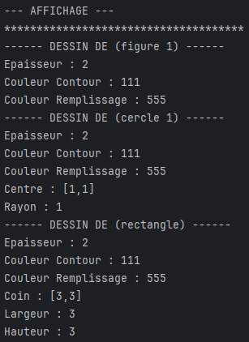
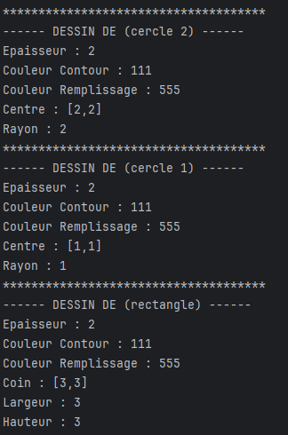
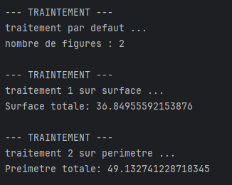
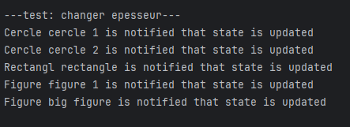

# Examen-Blanc-Design-Pattern

## 1- Designs pattern :
#### Composite : 
car une figure peut etre composée de plusieurs figures, donc c'est une arbre
#### Observer : 
car le parametreage doit notifier les element de chaque changement d'etat qu'il subit
#### Startegy : 
car il y a une famille d'algorithme de traitement qui doit etre dynamiquement interchangeable et evolue independament du dessin

## 2- Test de modèle 

#### on vas créer un figure "figure 1" qui sera composer d'une cercle "cercle 1" et d'un rectangle.
#### puis on vas créer un autre figure "big figure" qui sera composer de (figure 1) et (cercle 2).
#### le dessin sera des 2 figures

### test de l'affichage
#### affichage de big figure (figure 1: (cercle 1, rectangle) , cercle 2)

#### affichage de big figure (figure 1: (cercle 1, rectangle)

### traintement par differente startegies dynamiquemet interchangeable

### chnger etat et notifier les observers
